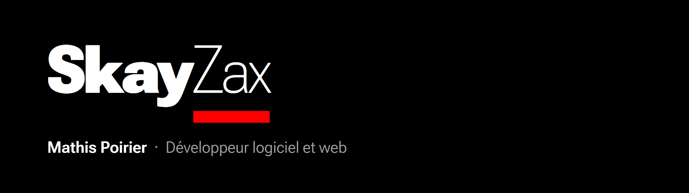
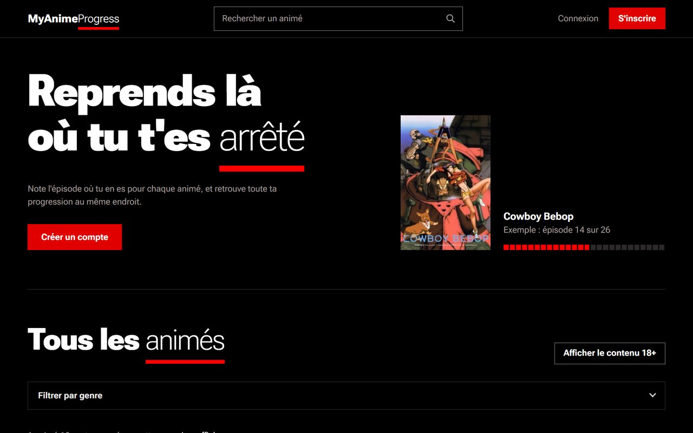

Étudiant en **BUT Informatique**, je fais des logiciels de bureau en **JavaFX** et des **applications web**.

**À la recherche d'un stage ou d'une alternance pour 2026-2027.**

## À la une

<table>
  <tr>
    <td width="55%"></td>
    <td>
      <h3><a href="https://github.com/SkayZax/MyAnimeProgress">MyAnimeProgress</a></h3>
      
Je voulais savoir où j'en étais dans mes animés. Alors j'ai fait un site pour noter l'épisode, voir le temps passé et retrouver mes favoris.

      
<b>Python, Flask, SQLite</b> Projet personnel, en ligne

      
<a href="https://anime.skayzax.fr"><b>Voir le site</b></a> · <a href="https://github.com/SkayZax/MyAnimeProgress">Code</a>

    </td>
  </tr>
</table>

## Mes autres projets

| Projet | En bref | Avec |
|---|---|---|
| [**Pac-Man**](https://github.com/SkayZax/pacman) | Le jeu d'arcade refait à quatre, avec quatre fantômes et une carte générée | Java, JavaFX |
| [**BomberMan**](https://github.com/SkayZax/BomberMan) | Carte aléatoire et ennemis mobiles, en MVC avec une façade | Java, JavaFX |
| [**OdeFrance**](https://github.com/SkayZax/odefrance) | Gestion des stocks et des commandes d'un vendeur d'eau fictif, à quatre | Java, JavaFX |
| [**LARSEN**](https://github.com/SkayZax/marthon-web) | Blog sur le grunge, fait en équipe pendant un marathon web | PHP, Laravel |
| [**LenSymphony**](https://github.com/SkayZax/lenSymphony) | Gestion de partitions musicales, à trois (projet inachevé) | PHP, Laravel |

Détails et captures de la plupart sur [mon portfolio](https://skayzax.fr).

## Ce que j'utilise

**Langages**

**Frameworks**

**Outils**

 

Un stage, une alternance, une question ? **[Écris-moi depuis mon portfolio](https://skayzax.fr)**.

